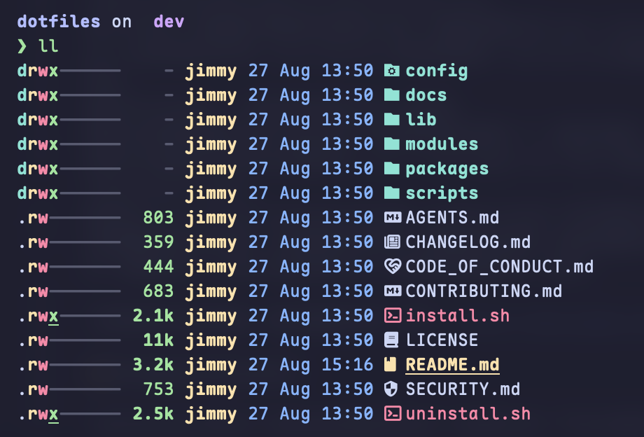

# Sandlight Dotfiles

A small, public-safe dotfiles toolkit for macOS, Ubuntu/Debian Linux, and WSL2. It uses defensive Bash, opt-in modules, and local overrides instead of machine-specific profiles.

<p align="center">
  
</p>

## Platform support

| Platform | Status | Package manager |
| --- | --- | --- |
| macOS | Supported | Homebrew |
| Ubuntu 24.04+ | Supported | apt |
| Debian 12+ | Supported | apt |
| WSL2 with Ubuntu/Debian | Supported | apt |
| Native Windows | Not supported | — |

## Quick start

```bash
git clone https://github.com/sandlight-studio/dotfiles.git ~/dotfiles
cd ~/dotfiles
./install.sh --dry-run
./install.sh
```

Configuration is optional. To customize modules or proxy endpoints:

```bash
mkdir -p "${XDG_CONFIG_HOME:-$HOME/.config}/sandlight-dotfiles"
cp config/config.env.example "${XDG_CONFIG_HOME:-$HOME/.config}/sandlight-dotfiles/config.env"
${EDITOR:-vi} "${XDG_CONFIG_HOME:-$HOME/.config}/sandlight-dotfiles/config.env"
./install.sh --dry-run
./install.sh
```

Package installation is always explicit:

```bash
./install.sh --with-packages
```

The installer does not bootstrap Homebrew. Install Homebrew first on macOS if package installation is requested. A failed package install does not stop configuration from being applied; the run exits with status 2 and prints the command to re-run. Add `--strict-packages` to stop at the first failure instead.

## Modules

The default module set is `shell,git,cli`.

| Module | Behavior |
| --- | --- |
| `shell` | Adds managed Bash and Zsh source blocks with portable PATH helpers, zsh completion, a history filter for secret values, and local extension hooks. |
| `git` | Adds an identity-free Git include, placed first so your own settings win, without changing name, email, signing, or credentials. |
| `cli` | Provides aliases and fzf, zoxide, eza, and bat integration for tools that are installed. |
| `terminal` | Installs neutral tmux (vi copy mode, per-platform clipboard) and Starship configuration. |
| `proxy` | Provides opt-in, provider-neutral `proxy_on`, `proxy_off`, and `proxy_status` helpers. |

Select modules in `config.env` or for one installation:

```bash
./install.sh --modules shell,git,cli,terminal,proxy
```

## Safe ownership and rollback

Conflicting managed files are backed up below `${XDG_STATE_HOME:-$HOME/.local/state}/sandlight-dotfiles/backups/`. The state manifest records every managed link, shell block, and Git include.

```bash
./uninstall.sh --dry-run
./uninstall.sh
```

Uninstall removes only content still owned by this project. It does not remove packages.

## Development

```bash
bash scripts/tests/run-all.sh
bash scripts/check-public-safety.sh
```

See [configuration](docs/CONFIGURATION.md), [architecture](docs/ARCHITECTURE.md), and [security](SECURITY.md) for details.

## License

Apache-2.0

